# IrisTech Game Engine

IrisTech is a custom 3D game engine written in C++ and developed from scratch.

The project focuses on real-time rendering, engine architecture, scene management,
graphics programming, animation, deformation, and game development technologies.
It also powers **Pedal to the Medal**, an arcade-driving game used to test IrisTech
on Windows and Android.

> This repository serves as a public technical showcase of the project.

---

## Features

Engine features include:

- 3D rendering with bgfx and DirectX 11
- Custom vertex and fragment shader pipeline
- Material and texture systems
- Directional lighting and multiple point lights
- Dynamic shadows and shadow mapping
- Point-light shadow cubemaps
- Configurable lighting and shadow settings
- Entity Component System based on EnTT
- Hierarchical scene graph, groups, and child entities
- Scene and project serialization
- Frustum culling and shadow visibility optimizations
- Experimental occlusion culling and portal culling
- Camera system and model loading
- ImGui-based scene editor with docking panels
- Hierarchy, Inspector, and transform manipulation tools
- Play Mode with a separate runtime scene state
- Skeletal animation and animation editing tools
- Lua scripting integration
- miniaudio-based audio system
- Tetrahedral Cage deformation system
- Spatial grid acceleration and experimental GPU deformation
- Debug counters and large-scene stress testing
- Windows game player and Android native game runtime
- Android touch input and on-screen game controls
- Project-based Windows and Android game build workflows
- Experimental Jolt Physics integration
- Atmospheric fog, automatic LOD, and model-streaming experiments
- CMake-based build system and Windows build packaging

---

## Tech Stack

Core engine technologies:

- **C++**
- **bgfx**, **bx**, and **bimg**
- **DirectX 11** (current Windows rendering backend)
- **SDL3**
- **EnTT**
- **Dear ImGui** (docking-enabled build)
- **GLM**
- **Lua 5.5**
- **Jolt Physics**
- **miniaudio**
- **nlohmann/json**

Development and build tools:

- **CMake** and **CMake Presets**
- **vcpkg**
- **Visual Studio 2022**, **MSVC**, and **MSBuild**
- **Windows SDK**
- **Android SDK**, **NDK**, and **Gradle**
- **PowerShell** shader build scripts
- **Git** and **GitHub Actions**
- **bgfx shader tools**

The vcpkg dependency and graphics toolchain also includes **cgltf**, **meshoptimizer**,
**glslang**, **SPIRV-Cross**, **SPIRV-Tools**, **SPIRV-Headers**, **stb**, **tinyexr**,
**miniz**, and supporting libraries. Some are transitive dependencies or build tools,
not separate engine subsystems.

---

## Game Showcase — Pedal to the Medal

**Pedal to the Medal** is an arcade-driving game built
with IrisTech. It is an end-to-end test project for the engine's rendering,
scene assets, game logic, input, and Android runtime. The project revisits a
driving-game remake originally developed with Unity in 2021–2022.

The Android gameplay build demonstrates:

- A 3D road environment with traffic vehicles and roadside scenery
- Nighttime lighting, atmospheric effects, and rainy weather
- On-screen steering, accelerator, brake, and pause controls
- A gameplay HUD with speed, score, high score, collected coins, and a multiplier
- Bonuses for close passes through traffic, objectives, boosts, and vehicle-condition feedback
- A run-summary screen with results, retry, and main-menu controls
- Game content running through the IrisTech mobile runtime

### Android Gameplay Gallery

Click a screenshot to view it at full resolution.

<table>
  <tr>
    <td align="center" width="25%">
      <a href="screenshots/pedal-to-the-medal-android-rain.png">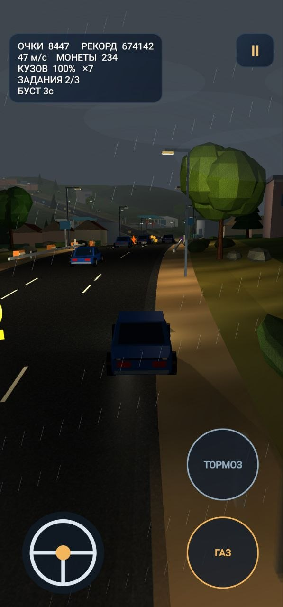</a> 
      Rainy night drive
    </td>
    <td align="center" width="25%">
      <a href="screenshots/pedal-to-the-medal-daytime-highway.png">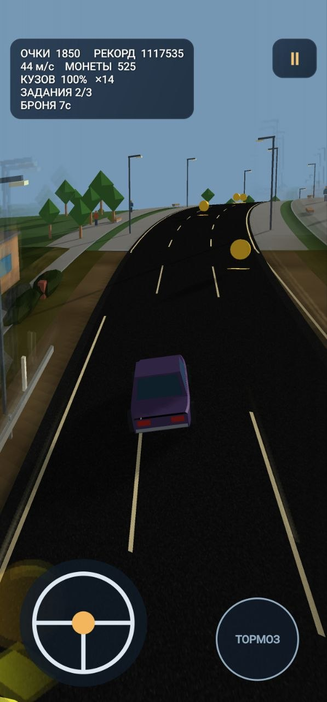</a> 
      Daytime highway
    </td>
    <td align="center" width="25%">
      <a href="screenshots/pedal-to-the-medal-traffic-streak.png">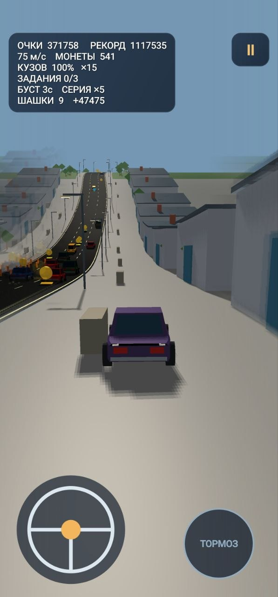</a> 
      Traffic streak
    </td>
    <td align="center" width="25%">
      <a href="screenshots/pedal-to-the-medal-hillside-road.png">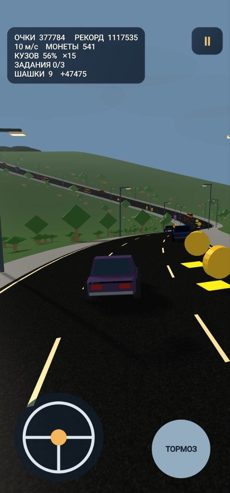</a> 
      Hillside roads
    </td>
  </tr>
  <tr>
    <td align="center" width="25%">
      <a href="screenshots/pedal-to-the-medal-city-streets.png">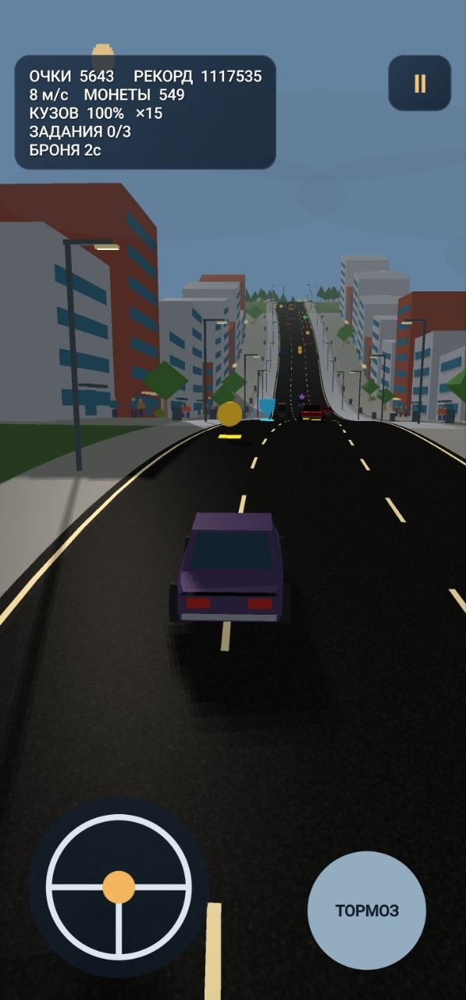</a> 
      Urban district
    </td>
    <td align="center" width="25%">
      <a href="screenshots/pedal-to-the-medal-rainy-downhill.png">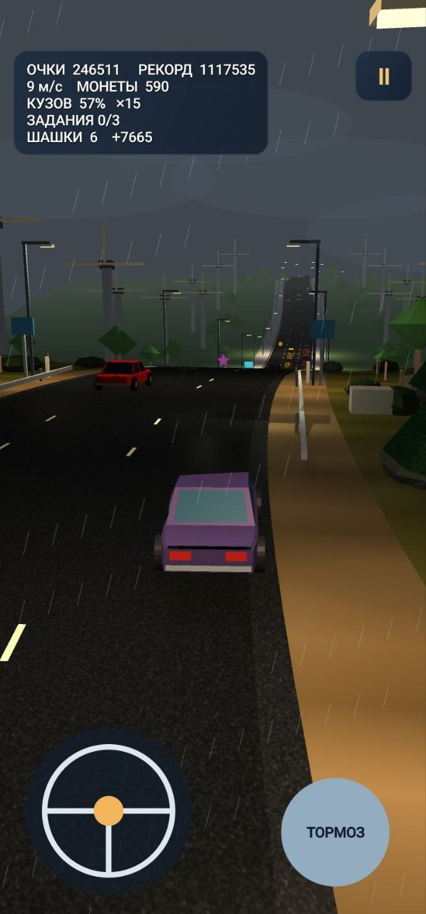</a> 
      Rainy downhill
    </td>
    <td align="center" width="25%">
      <a href="screenshots/pedal-to-the-medal-rainy-traffic.png">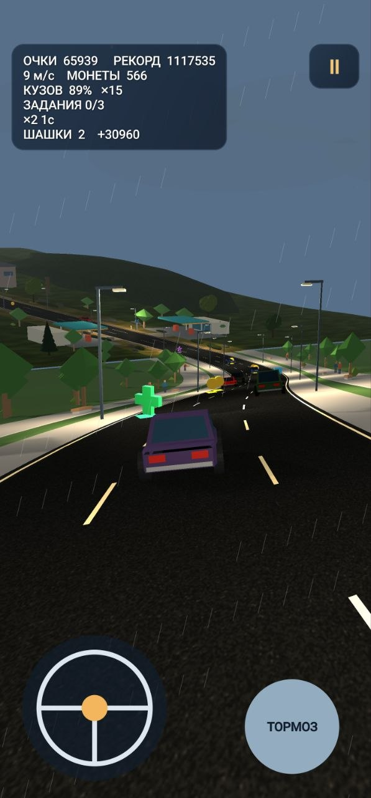</a> 
      Rain & pickups
    </td>
    <td align="center" width="25%">
      <a href="screenshots/pedal-to-the-medal-run-summary.png">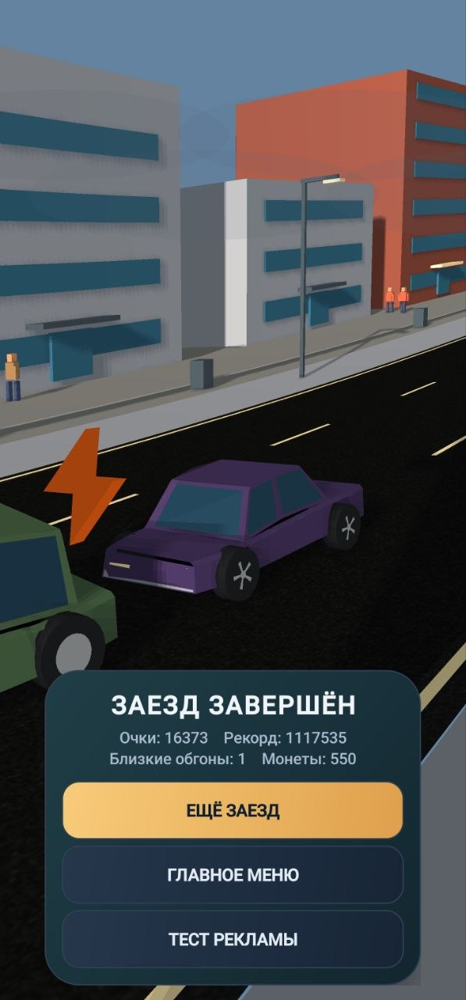</a> 
      Run summary
    </td>
  </tr>
</table>

*Pedal to the Medal on Android — daytime and rainy conditions, hilly and urban
roads, traffic overtakes, collectibles, touch controls, and the run-summary UI.*

The game serves as a practical integration test for a standalone project that
runs on the engine without requiring game-specific changes to its core.

---

## Screenshots

### Dark Castle — Lighting & Shadows

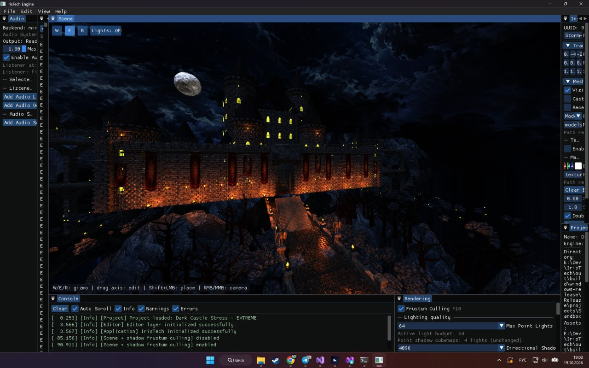

A large dark-fantasy castle scene demonstrating textured models, multiple lights,
real-time shadows, atmospheric rendering, and editor tools.

### Scene Editor — Hierarchy & Play Mode

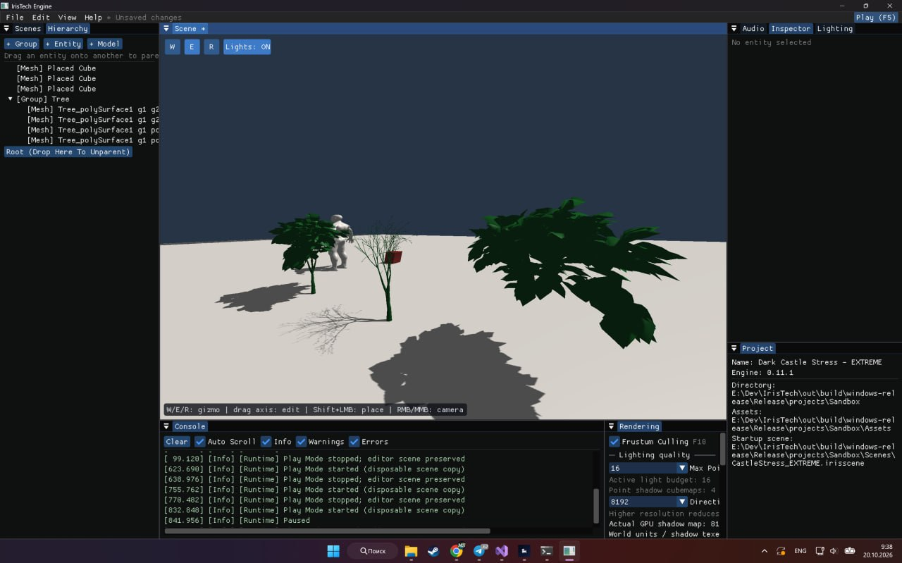

Editor interface with hierarchical scene objects, model and transform tools,
rendering controls, and Play Mode.

### Forest Scene — Vegetation & Tetrahedral Cage Tests

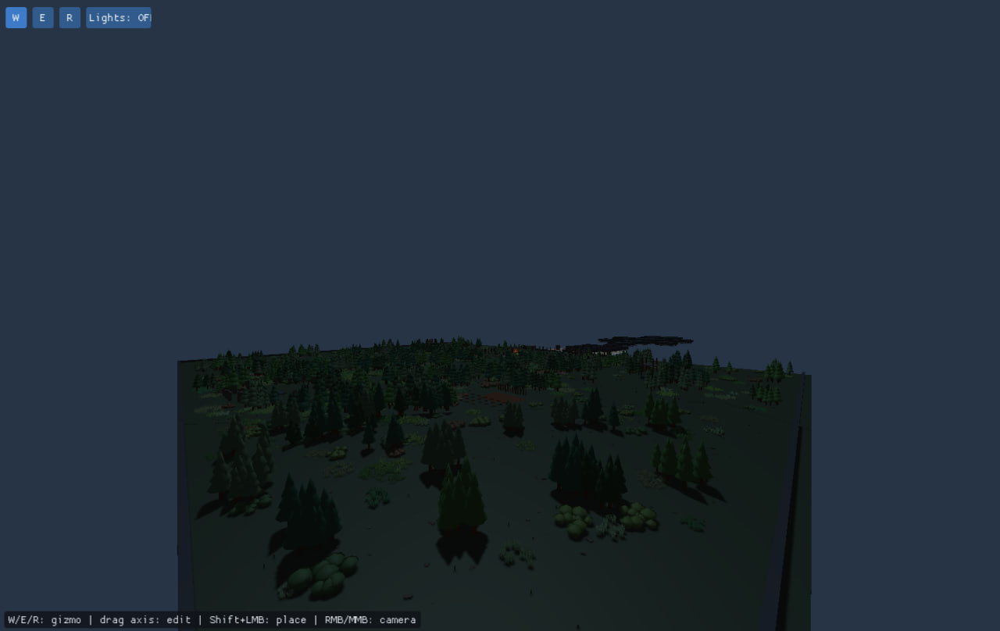

A dense forest environment used for vegetation-related Tetrahedral Cage
experiments, as well as rendering stress tests and shadow visibility analysis.

### Forest Debug Visualization — Cage Experiments

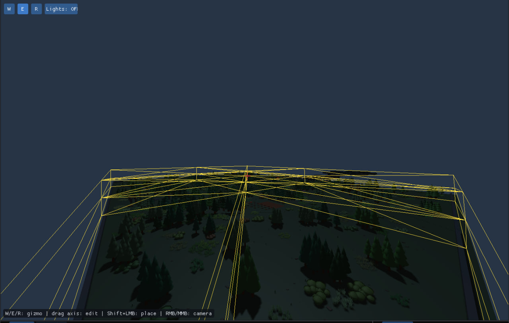

Development-time geometry and debug overlays from the forest vegetation tests,
used to inspect scene structure and deformation-related geometry.

### Earlier Rendering Experiments

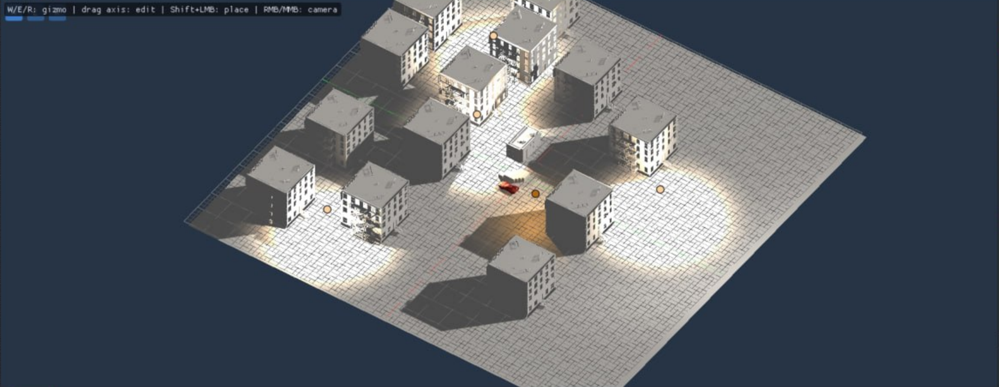

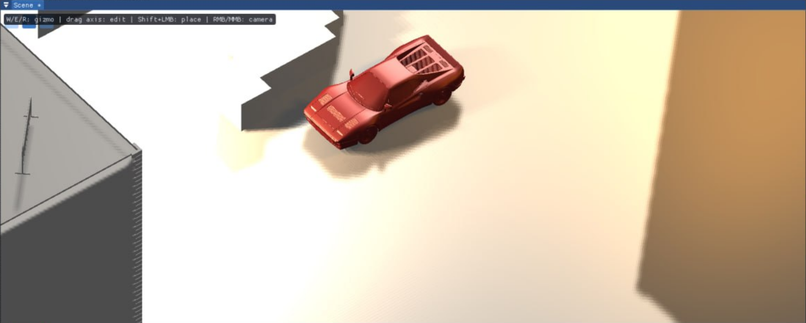

Earlier tests of scene editing, materials, lighting, and shadow mapping.

---

## Rendering

The rendering system provides real-time 3D graphics, lighting, and scene visualization.

Rendering features include:

- 3D mesh rendering
- Material and texture parameters
- Custom vertex and fragment shaders
- Directional and point lights
- Dynamic shadow maps
- Point-light shadow cubemaps
- Camera-based scene rendering
- Frustum culling
- Experimental occlusion and portal culling
- Render targets
- Debug rendering and performance counters

The renderer currently uses **bgfx** with the **DirectX 11 backend** on Windows.

---

## Lighting & Shadows

IrisTech supports configurable directional lighting and multiple point lights.

Lighting functionality includes:

- Light direction, position, color, and intensity
- Point-light radius and attenuation
- Ambient lighting
- Directional shadow maps
- Point-light cubemap shadows
- Shadow quality controls
- Frustum-based shadow rendering optimizations

---

## Entity Component System

IrisTech uses **EnTT** as the foundation of its Entity Component System.

Scene entities can contain independent components such as:

- Transform
- Mesh Renderer
- Materials
- Lights
- Camera-related data
- Animation and script-related data

The scene graph supports parent-child relationships, object groups, and nested objects.

---

## Scene System

The engine contains its own scene and project management system.

Scene functionality includes:

- Scene creation, loading, and saving
- Project files (`.irisproj`)
- Scene files (`.irisscene`)
- Entity and component serialization
- Hierarchical scene objects
- Model import and placement
- Separate editor and Play Mode scene states

Game projects can target the Windows player and the Android native runtime.
The Android workflow uses project assets, a generated Gradle app, and a
prebuilt mobile engine library rather than bundling private engine sources.

---

## Editor

IrisTech includes editor tools built with **Dear ImGui**.

Editor functionality includes:

- Scene viewport and camera navigation
- Hierarchy and Inspector panels
- Object selection and transform gizmos
- Group and subgroup management
- Material and lighting controls
- Model placement
- Audio controls
- Animation editing and preview tools
- Play Mode
- Debug console and rendering statistics

---

## Tetrahedral Cage Deformation

IrisTech includes an independently developed Tetrahedral Cage deformation system.

Current implementation includes:

- Tetrahedral mesh validation
- Cached inverse rest-pose bases
- AABB filtering and spatial grid acceleration
- Barycentric vertex binding
- Batch deformation of bound mesh vertices
- Support for multiple tetrahedra
- Dedicated regression tests for the CPU deformation pipeline
- Experimental GPU deformation work

IrisTech features a custom C++ Tetrahedral Cage deformation pipeline that binds
render meshes to volumetric cages using barycentric coordinates. AABB filtering,
spatial-grid acceleration, and batch processing support complex deformation workflows.
The forest screenshots above document tests involving vegetation and cage-related
geometry visualization.

---

## Animation, Scripting & Audio

Animation, scripting, and audio are integrated with the editor and game runtime.

Functionality includes:

- Skeletal animation, rigs, clips, and keyframes
- Animation preview and editing tools
- Custom `.irig` rig assets
- Lua script runtime and scripts associated with scene objects
- Script examples for game logic and interactions
- miniaudio playback and editor audio controls

---

## Performance

Rendering performance is an important part of the project.

Optimization techniques and tools include:

- Frustum culling
- Experimental occlusion culling
- Experimental portal culling
- Shadow visibility optimizations
- Spatial data structures for deformation
- Shared rendering resources
- Rendering statistics and dense stress-test scenes
- Experimental parallel preparation and GPU deformation paths

The screenshots demonstrate development scenes, not measured FPS benchmarks.

---

## Author & Links

**Maxim Bastrykin**

- **Personal Website / Portfolio:** [mbastrykin.ru](https://mbastrykin.ru)
- **GitHub:** [github.com/mbastrykin](https://github.com/mbastrykin)

---
