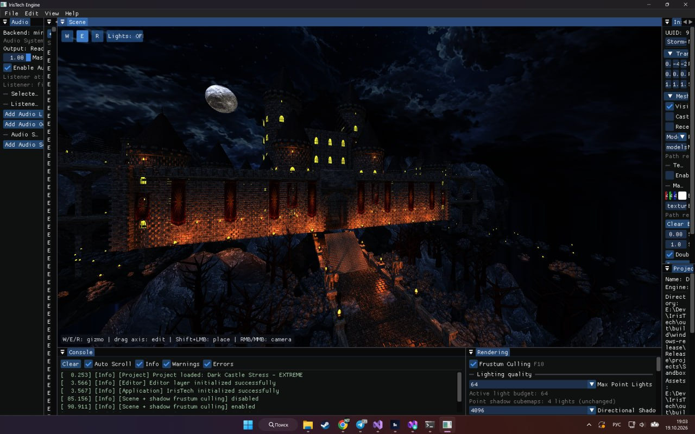
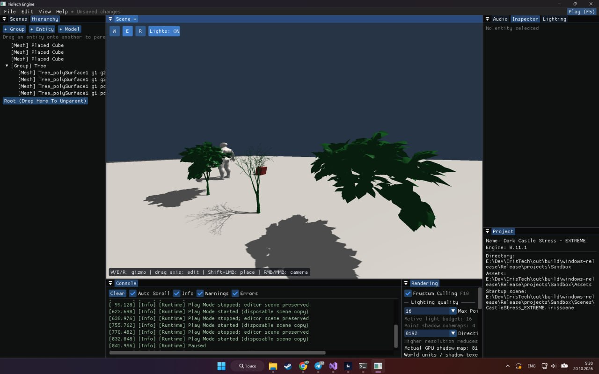
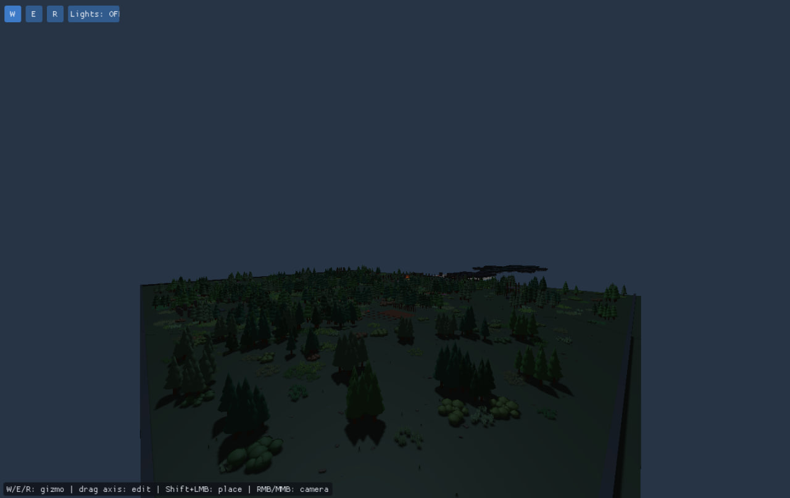
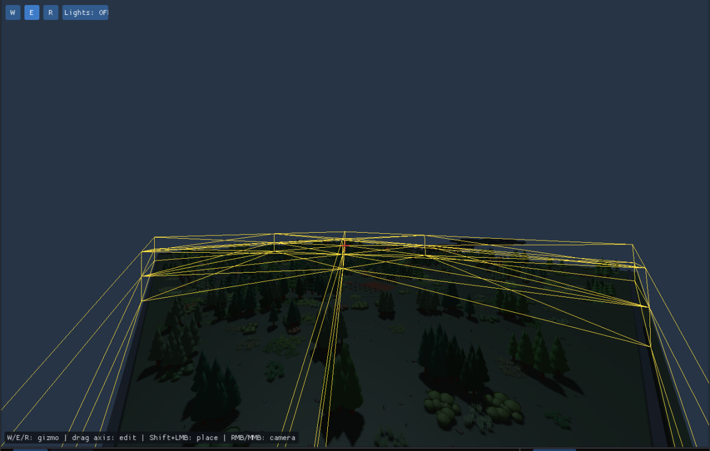
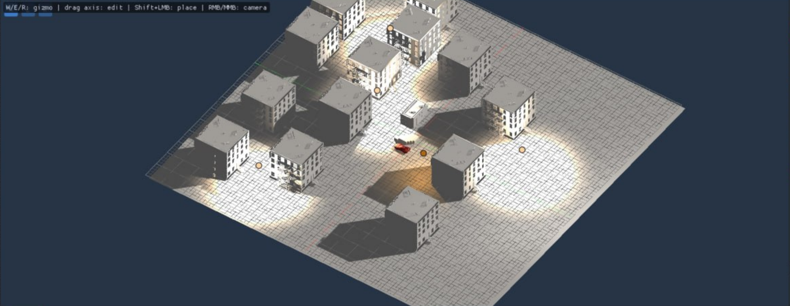
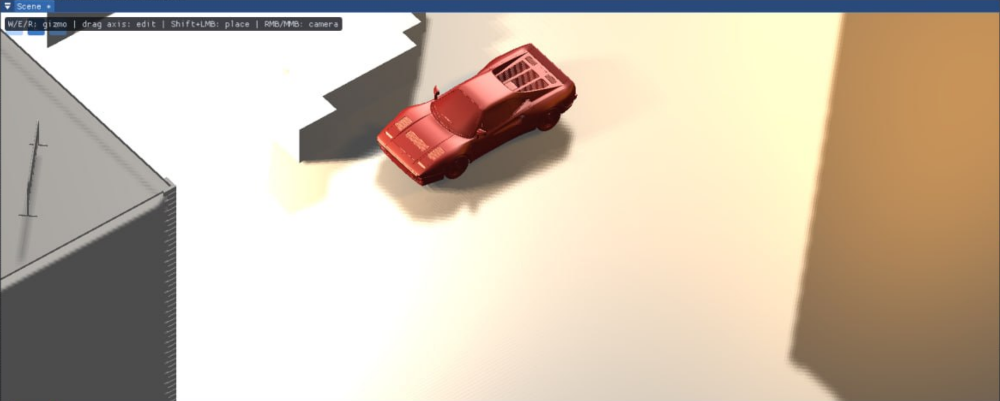

# IrisTech Game Engine

IrisTech is a custom 3D game engine written in C++ and developed from scratch.

The project focuses on real-time rendering, engine architecture, scene management,
graphics programming, animation, deformation, and game development technologies.

> This repository serves as a public technical showcase of the project.

---

## Features

Engine features include:

- 3D rendering with bgfx and DirectX 11
- Custom vertex and fragment shader pipeline
- Material and texture systems
- Directional lighting and multiple point lights
- Dynamic shadows and shadow mapping
- Point-light shadow cubemaps
- Configurable lighting and shadow settings
- Entity Component System based on EnTT
- Hierarchical scene graph, groups, and child entities
- Scene and project serialization
- Frustum culling and shadow visibility optimizations
- Experimental occlusion culling and portal culling
- Camera system and model loading
- ImGui-based scene editor with docking panels
- Hierarchy, Inspector, and transform manipulation tools
- Play Mode with a separate runtime scene state
- Skeletal animation and animation editing tools
- Lua scripting integration
- miniaudio-based audio system
- Tetrahedral Cage deformation system
- Spatial grid acceleration and experimental GPU deformation
- Debug counters and large-scene stress testing
- CMake-based build system and Windows build packaging

---

## Tech Stack

Core engine technologies:

- **C++**
- **bgfx**
- **DirectX 11** (current Windows rendering backend)
- **SDL3**
- **EnTT**
- **Dear ImGui** (docking-enabled build)
- **GLM**
- **Lua 5.5**
- **miniaudio**
- **nlohmann/json**

Development and build tools:

- **CMake** and **CMake Presets**
- **vcpkg**
- **Visual Studio 2022**, **MSVC**, and **MSBuild**
- **Windows SDK**
- **PowerShell** shader build scripts
- **Git** and **GitHub Actions**
- **bgfx shader tools**

The vcpkg dependency and graphics toolchain also includes **cgltf**, **meshoptimizer**,
**glslang**, **SPIRV-Cross**, **SPIRV-Tools**, **SPIRV-Headers**, **stb**, **tinyexr**,
**miniz**, and supporting libraries. Some are transitive dependencies or build tools,
not separate engine subsystems.

---

## Screenshots

### Dark Castle — Lighting & Shadows

A large dark-fantasy castle scene demonstrating textured models, multiple lights,
real-time shadows, atmospheric rendering, and editor tools.

### Scene Editor — Hierarchy & Play Mode

Editor interface with hierarchical scene objects, model and transform tools,
rendering controls, and Play Mode.

### Forest Stress Scene

A dense test environment with large amounts of vegetation and shadow-casting objects.
Used to investigate rendering performance and visibility culling.

### Debug Visualization

Development-time wireframe and debug overlays displayed in the forest scene.

### Earlier Rendering Experiments

Earlier tests of scene editing, materials, lighting, and shadow mapping.

---

## Rendering

The rendering system provides real-time 3D graphics, lighting, and scene visualization.

Rendering features include:

- 3D mesh rendering
- Material and texture parameters
- Custom vertex and fragment shaders
- Directional and point lights
- Dynamic shadow maps
- Point-light shadow cubemaps
- Camera-based scene rendering
- Frustum culling
- Experimental occlusion and portal culling
- Render targets
- Debug rendering and performance counters

The renderer currently uses **bgfx** with the **DirectX 11 backend** on Windows.

---

## Lighting & Shadows

IrisTech supports configurable directional lighting and multiple point lights.

Lighting functionality includes:

- Light direction, position, color, and intensity
- Point-light radius and attenuation
- Ambient lighting
- Directional shadow maps
- Point-light cubemap shadows
- Shadow quality controls
- Frustum-based shadow rendering optimizations

---

## Entity Component System

IrisTech uses **EnTT** as the foundation of its Entity Component System.

Scene entities can contain independent components such as:

- Transform
- Mesh Renderer
- Materials
- Lights
- Camera-related data
- Animation and script-related data

The scene graph supports parent-child relationships, object groups, and nested objects.

---

## Scene System

The engine contains its own scene and project management system.

Scene functionality includes:

- Scene creation, loading, and saving
- Project files (`.irisproj`)
- Scene files (`.irisscene`)
- Entity and component serialization
- Hierarchical scene objects
- Model import and placement
- Separate editor and Play Mode scene states

---

## Editor

IrisTech includes editor tools built with **Dear ImGui**.

Editor functionality includes:

- Scene viewport and camera navigation
- Hierarchy and Inspector panels
- Object selection and transform gizmos
- Group and subgroup management
- Material and lighting controls
- Model placement
- Audio controls
- Animation editing and preview tools
- Play Mode
- Debug console and rendering statistics

---

## Tetrahedral Cage Deformation

IrisTech includes an independently developed Tetrahedral Cage deformation system.

Current implementation includes:

- Tetrahedral mesh validation
- Cached inverse rest-pose bases
- AABB filtering and spatial grid acceleration
- Barycentric vertex binding
- Batch deformation of bound mesh vertices
- Support for multiple tetrahedra
- Dedicated regression tests for the CPU deformation pipeline
- Experimental GPU deformation work

IrisTech features a custom C++ Tetrahedral Cage deformation pipeline that binds
render meshes to volumetric cages using barycentric coordinates. AABB filtering,
spatial-grid acceleration, and batch processing support complex deformation workflows.

---

## Animation, Scripting & Audio

Animation, scripting, and audio are integrated with the editor and game runtime.

Functionality includes:

- Skeletal animation, rigs, clips, and keyframes
- Animation preview and editing tools
- Custom `.irig` rig assets
- Lua script runtime and scripts associated with scene objects
- Script examples for game logic and interactions
- miniaudio playback and editor audio controls

---

## Performance

Rendering performance is an important part of the project.

Optimization techniques and tools include:

- Frustum culling
- Experimental occlusion culling
- Experimental portal culling
- Shadow visibility optimizations
- Spatial data structures for deformation
- Shared rendering resources
- Rendering statistics and dense stress-test scenes
- Experimental parallel preparation and GPU deformation paths

The screenshots demonstrate development scenes, not measured FPS benchmarks.

---
